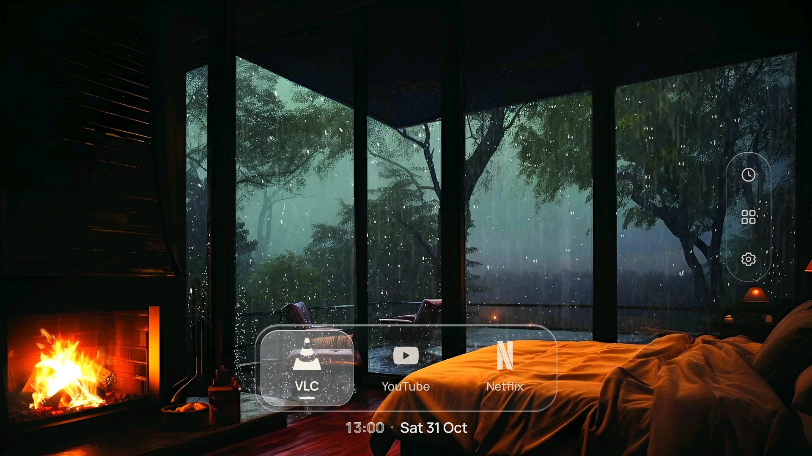
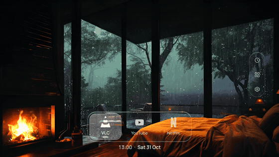
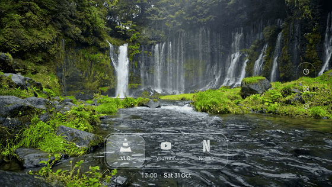
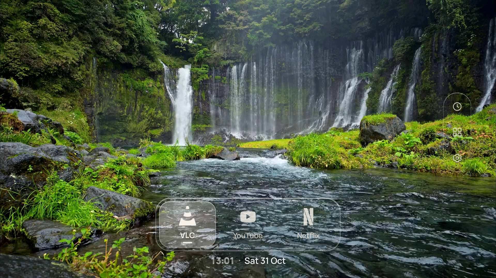
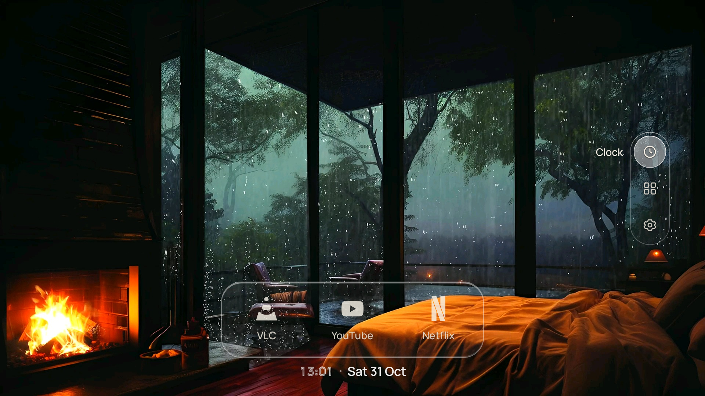
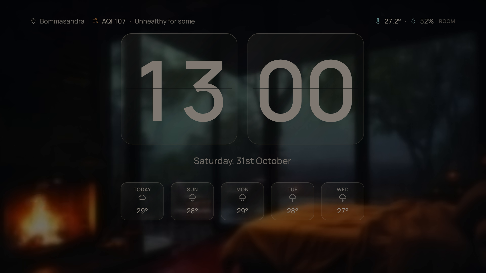
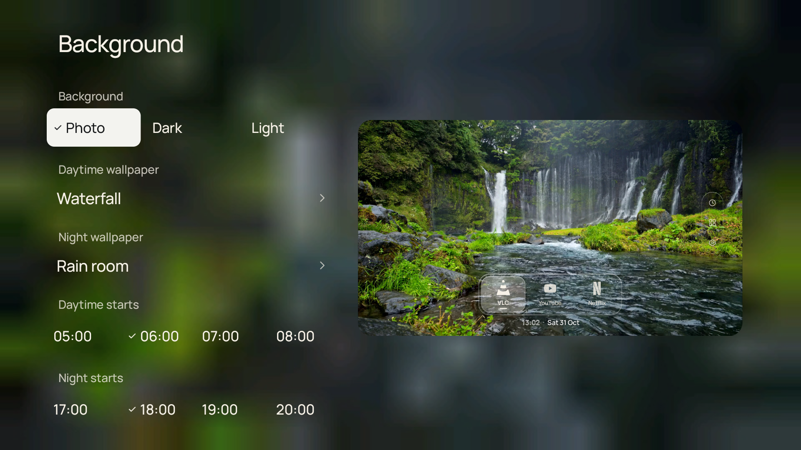

# MinimalTV

**Make your Android TV fast again.** MinimalTV removes the apps you don't use, replaces the
heavy stock home screen with a light one, and leaves you with a clean, minimal screen.

- **Faster:** more free memory and quicker menus. You approve every app before it's removed.
- **Minimal:** just your apps, the time and the date. No ads, rows or autoplaying trailers.
- **Screensaver:** a clock with the date and the week's weather.
- **Reversible:** every change can be undone.



## Install

**You need:** an Android TV or Google TV (Android 11 or later), a computer on the same Wi-Fi,
an AI agent on that computer (such as [Claude Code](https://claude.com/claude-code)) and the TV
remote.

1. Connect the TV and the computer to the same Wi-Fi.
2. Copy this link into your AI agent and say **"Make my TV fast with this"**:

   ```
   https://github.com/amitprna/MinimalTV
   ```

The agent will ask you to press a few buttons on the remote once, so the computer can connect.
It shows you which apps it wants to remove and waits for your OK. To undo, ask it:
**"Undo MinimalTV on my TV"**.

## Night and day

| Night | Day |
| --- | --- |
| [](docs/media/night.mp4) | [](docs/media/day.mp4) |

Optional live wallpapers with sound: rain at night, a waterfall by day. Click a picture to play
it with sound.

<details>
<summary><b>More screenshots</b></summary>

| Home by day | App menu |
| --- | --- |
|  |  |
| **Screensaver** | **Settings** |
|  |  |

</details>

<details>
<summary><b>What it changes</b></summary>

- **Unused apps:** removed for your user only (nothing is deleted from the TV's system), after a
  backup. The agent uses [`speedup/apps.md`](speedup/apps.md): safe-to-remove apps, apps it asks
  you about (streaming apps, casting, voice search), and apps it never touches (remote, HDMI
  inputs, Play Store and services).
- **Home screen:** MinimalTV replaces the stock one, which is usually the heaviest app on the
  TV. It also becomes the screensaver.
- **Animations:** set to half length, if you agree.
- **Undo:** `speedup/restore.sh` brings apps back; a factory reset restores everything.

</details>

<details>
<summary><b>Install it yourself (no AI agent)</b></summary>

1. **On the TV:** Settings › System › About › select **Android TV OS build** seven times. Then
   Settings › System › Developer options › turn on **USB debugging** (and **Network debugging**
   if there is one). Note the TV's IP address from Settings › Network & Internet › your Wi-Fi.
2. **On the computer:** install [platform-tools](https://developer.android.com/tools/releases/platform-tools)
   (Windows: `winget install Google.PlatformTools`, macOS: `brew install android-platform-tools`).
3. Connect, and choose **Allow** on the TV:

   ```bash
   adb connect 192.168.1.20:5555   # your TV's IP
   ```

4. Remove apps you don't use. Check [`speedup/apps.md`](speedup/apps.md) first:

   ```bash
   TV=192.168.1.20:5555 speedup/remove.sh com.google.android.tvrecommendations com.google.android.backdrop
   ```

5. Install MinimalTV from [Releases](https://github.com/amitprna/MinimalTV/releases/latest) and set it up:

   ```bash
   adb install -r MinimalTV.apk
   adb shell settings put secure screensaver_components io.github.amitprna.minimaltv/.ClockDream
   adb shell pm grant io.github.amitprna.minimaltv android.permission.WRITE_SECURE_SETTINGS
   ```

6. Press **Home** and pick **MinimalTV** › **Always**. If the old home screen still opens,
   remove it with `speedup/remove.sh` (package names in `speedup/apps.md`).
7. Optional: weather, live wallpapers and a room sensor. See [AGENTS.md](AGENTS.md), steps 5–6
   and the sections after them.

</details>

<details>
<summary><b>Build from source</b></summary>

JDK 17, Android SDK 34 and Gradle 8.7:

```bash
cd launcher
gradle assembleRelease   # app/build/outputs/apk/release/app-release.apk
```

Plain Java, no AndroidX. The wallpaper video plays on the TV's hardware video layer
(`SurfaceView`) rather than through the app, so it costs almost no CPU.

</details>

## Credits

Home screen design ported from [CleanFrame](https://github.com/nthnclrk/CleanFrame) (MIT).
Fonts under SIL OFL, icons from [Simple Icons](https://simpleicons.org) (CC0), weather from
[Open-Meteo](https://open-meteo.com/), scenes from Pixabay. Details in
[`launcher/licenses`](launcher/licenses/README.md).

MIT licence. See [LICENSE](LICENSE).
